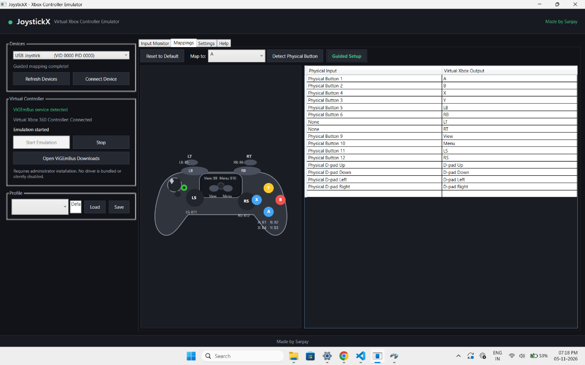
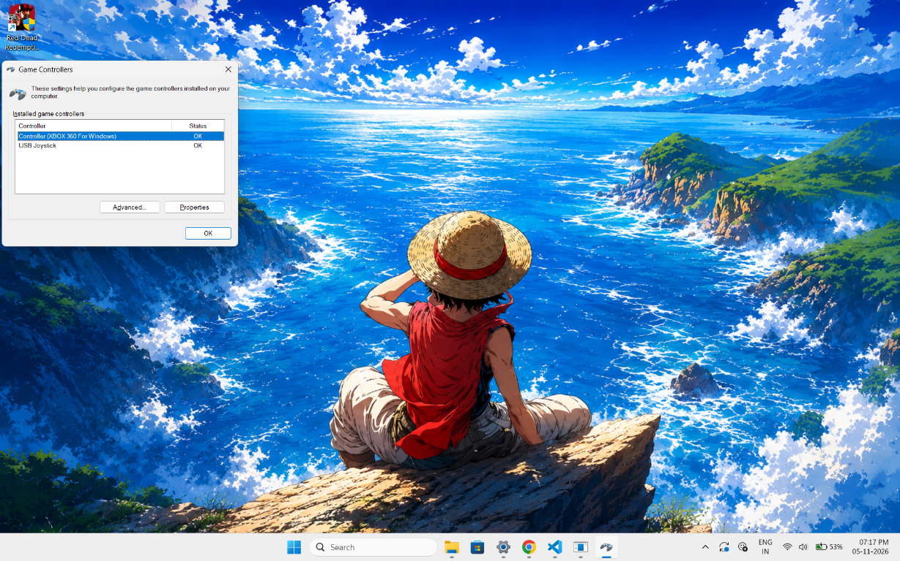

# JoystickX



JoystickX is a Windows desktop application that connects a physical USB joystick or gamepad and creates a virtual Xbox 360 controller. It uses DirectInput to read the physical device and ViGEmBus to expose the virtual controller to Windows and games.

Made by **Sanjay**.

## Features

- Physical USB controller detection
- Guided calibration for buttons, triggers, D-pad directions, and right-stick axes
- Xbox A, B, X, Y, LB, RB, LT, RT, View, Menu and stick buttons
- D-pad Up, Down, Left and Right mapping
- Adjustable stick and trigger settings
- Named JSON profiles
- Virtual Xbox 360 controller detection in Windows
- Compatible with games and launchers that support Xbox 360 controllers

## Screenshots

### Controller detected by Windows



Open Windows **Game Controllers** with `Win + R`, then run `joy.cpl`. The physical Joystick entry or controller name should appear while testing.

### JoystickX application


## Download

Download the latest application ZIP from the GitHub **Releases** page.

1. Download `JoystickX-win-x64.zip`.
2. Extract the ZIP to a folder such as `Documents\JoystickX`.
3. Open the extracted folder.
4. Run `JoystickX.exe`.

The ZIP uses a framework-independent build with the required application files included. Do not run it directly from inside the ZIP archive.

## Simple installation steps

### 1. Install ViGEmBus

Open PowerShell or Windows Terminal as Administrator and run:

```powershell
winget install --exact --id ViGEm.ViGEmBus
```

Restart Windows if the installer or ViGEm prompts you to reboot.

Official manual download:

https://vigem.org/downloads/

### 2. Install .NET 8 Desktop Runtime

If `JoystickX.exe` does not start, install the Windows x64 Desktop Runtime:

```powershell
winget install --exact --id Microsoft.DotNet.DesktopRuntime.8
```

### 3. Connect the gamepad

1. Connect the USB gamepad.
2. Press `Win + R`.
3. Enter `joy.cpl`.
4. Confirm the physical controller appears and test its buttons.

### 4. Start JoystickX

1. Run `JoystickX.exe`.
2. Select the controller in **Devices**.
3. Select **Connect Device**.
4. Select **Start Emulation**.
5. In Windows, press `Win + R`, enter `joy.cpl`, and confirm **Xbox 360 Controller for Windows** appears.

## Guided calibration

1. Connect and start the physical controller.
2. Open the **Mappings** tab.
3. Select **Guided Setup**.
4. Every physical button is initially shown as unmapped.
5. When an Xbox button, trigger, stick, or D-pad direction blinks, press the corresponding physical control.
6. During the right-stick step, move the right analog stick in each direction so JoystickX can detect its axes.
7. Release and press the next control only when prompted.
8. Save the resulting profile using the Profile panel.

Guided Setup maps:

- A, B, X, Y
- LB, RB
- LT, RT
- Back/View and Start/Menu
- Left Stick and Right Stick
- D-pad Up, Down, Left and Right

The default face-button mapping follows DirectInput button order: A = Button 1, B = Button 2, X = Button 3, and Y = Button 4. Canceling Guided Setup restores the mapping that was active before calibration.

The app prevents one physical control from being assigned to more than one virtual output during guided setup.

## Using with games

JoystickX works with PC games that use standard Xbox/XInput controllers, including:

- Steam games with Xbox controller support
- Game Pass PC games
- Red Dead Redemption 2
- GTA V and Rockstar launcher games
- Racing, fighting, action and emulator games with XInput support

Compatibility depends on each game. To avoid duplicate controller detection:

1. Start JoystickX before launching the game.
2. Open the game's controller settings.
3. Select Xbox 360 Controller/Xbox controller if the game offers a device choice.
4. If Steam Controller/Steam Input intercepts the physical device, disable or remove conflicting Steam layouts, or hide the physical device only after testing.

## Build from source

Requirements:

- Windows 10/11 x64
- .NET 8 SDK
- Visual Studio 2022 with the .NET desktop development workload is optional

```powershell
git clone https://github.com/sanjay-ld/JoystickX.git
cd JoystickX
dotnet restore JoystickX.sln
dotnet build JoystickX.sln -c Release
```

Run:

```powershell
dotnet run --project .\JoystickX\JoystickX.csproj
```

Create a release folder:

```powershell
dotnet publish .\JoystickX\JoystickX.csproj -c Release -r win-x64 --self-contained true -p:PublishSingleFile=false
```

## Troubleshooting

### Physical controller is not detected

- Confirm it appears in `joy.cpl`
- Reconnect the USB cable or controller
- Use another USB port
- Select **Refresh Devices**
- Try reconnecting and selecting **Connect Device**

### Xbox controller does not appear

- Install ViGEmBus
- Restart Windows
- Confirm ViGEmBus is installed
- Select **Start Emulation**
- Press `Win + R`, enter `joy.cpl`, and keep the window open while the app runs

### Buttons remain wrong after mapping

- Open **Mappings**
- Select **Reset to Default**
- Run **Guided Setup**
- Press only one physical control for each highlighted virtual output

### Stick movement is unstable

Open **Settings** and increase the left stick or right stick deadzone as required.

## Safety

JoystickX does not modify Windows driver signatures, disable Secure Boot, or bundle ViGEmBus installers. It reads only the connected physical controller and sends standard virtual Xbox controller updates.
